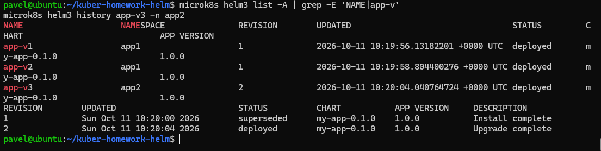
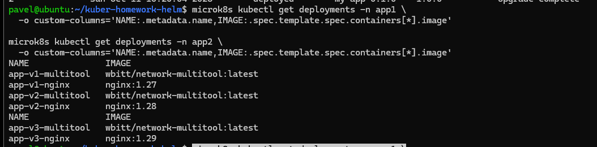
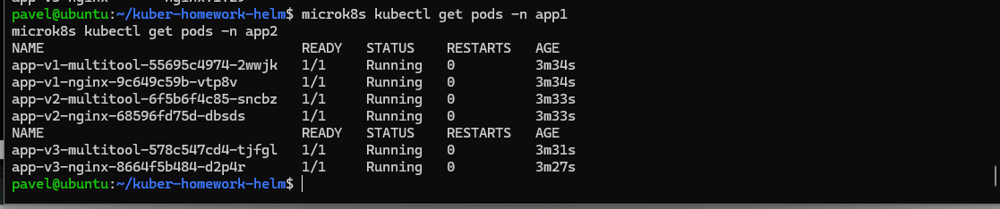

# Домашнее задание к занятию «Helm»

## Цель

В тестовой среде Kubernetes установить и обновить приложения с помощью Helm.

В работе используется MicroK8s и Helm 3.

## Задание 1. Подготовить Helm-чарт для приложения

Создан Helm-чарт `my-app` для развёртывания приложения в разных окружениях.

Приложение состоит из двух компонентов:

- `nginx`;
- `network-multitool`.

Каждый компонент разворачивается отдельным `Deployment`.

Структура чарта:

```text
my-app/
├── Chart.yaml
├── values.yaml
├── values-v1.yaml
├── values-v2.yaml
├── values-v3.yaml
└── templates/
    ├── nginx-deployment.yaml
    ├── multitool-deployment.yaml
    └── services.yaml
```

Версия nginx задаётся через переменные Helm. Для разных версий используются отдельные values-файлы:

```text
values-v1.yaml -> nginx:1.27
values-v2.yaml -> nginx:1.28
values-v3.yaml -> nginx:1.29
```

В шаблоне Deployment образ собирается из переменных чарта:

```yaml
image: "{{ .Values.nginx.image.repository }}:{{ .Values.nginx.image.tag }}"
```

Таким образом версию приложения можно менять через Helm values без изменения шаблона Deployment.

Проверка чарта:

```bash
microk8s helm3 lint ./my-app
```

Результат:

```text
1 chart(s) linted, 0 chart(s) failed
```

### Манифесты и values

- [Chart.yaml](my-app/Chart.yaml)
- [values.yaml](my-app/values.yaml)
- [values-v1.yaml](my-app/values-v1.yaml)
- [values-v2.yaml](my-app/values-v2.yaml)
- [values-v3.yaml](my-app/values-v3.yaml)
- [nginx-deployment.yaml](my-app/templates/nginx-deployment.yaml)
- [multitool-deployment.yaml](my-app/templates/multitool-deployment.yaml)
- [services.yaml](my-app/templates/services.yaml)

## Задание 2. Запустить две версии в одном namespace и третью в другом

Созданы три Helm release:

| Release | Namespace | Версия nginx |
|---|---|---|
| `app-v1` | `app1` | `nginx:1.27` |
| `app-v2` | `app1` | `nginx:1.28` |
| `app-v3` | `app2` | `nginx:1.29` |

### Установка app-v1

```bash
microk8s helm3 install app-v1 ./my-app \
  -n app1 \
  --create-namespace \
  -f my-app/values-v1.yaml
```

### Установка app-v2

```bash
microk8s helm3 install app-v2 ./my-app \
  -n app1 \
  -f my-app/values-v2.yaml
```

### Установка и обновление app-v3

Сначала релиз установлен в `app2` с версией `nginx:1.28`:

```bash
microk8s helm3 install app-v3 ./my-app \
  -n app2 \
  --create-namespace \
  -f my-app/values-v2.yaml
```

Затем приложение обновлено через Helm до `nginx:1.29`:

```bash
microk8s helm3 upgrade app-v3 ./my-app \
  -n app2 \
  -f my-app/values-v3.yaml
```

История релиза подтверждает установку и последующее обновление:

```text
REVISION  STATUS      DESCRIPTION
1         superseded  Install complete
2         deployed    Upgrade complete
```

## Результат

### Helm releases и история обновления

`app-v1` и `app-v2` запущены в namespace `app1`, `app-v3` — в namespace `app2`. Для `app-v3` текущая ревизия Helm — `2`.



### Проверка используемых образов

Фактически используются три версии nginx:

```text
app-v1-nginx -> nginx:1.27
app-v2-nginx -> nginx:1.28
app-v3-nginx -> nginx:1.29
```



### Проверка Pod

Все компоненты трёх релизов находятся в состоянии `Running`.



## Команды проверки

Проверка Helm releases:

```bash
microk8s helm3 list -A
```

Проверка истории обновления:

```bash
microk8s helm3 history app-v3 -n app2
```

Проверка Pod:

```bash
microk8s kubectl get pods -n app1
microk8s kubectl get pods -n app2
```

Проверка образов в Deployment:

```bash
microk8s kubectl get deployments -n app1 \
  -o custom-columns='NAME:.metadata.name,IMAGE:.spec.template.spec.containers[*].image'

microk8s kubectl get deployments -n app2 \
  -o custom-columns='NAME:.metadata.name,IMAGE:.spec.template.spec.containers[*].image'
```

## Итог

В результате:

- подготовлен Helm-чарт для приложения;
- `nginx` и `network-multitool` разворачиваются отдельными Deployment;
- версия nginx изменяется через переменные чарта;
- две версии приложения одновременно работают в namespace `app1`;
- третья версия работает в namespace `app2`;
- выполнено обновление приложения командой `helm upgrade`;
- результат подтверждён выводом `helm` и `kubectl`.
